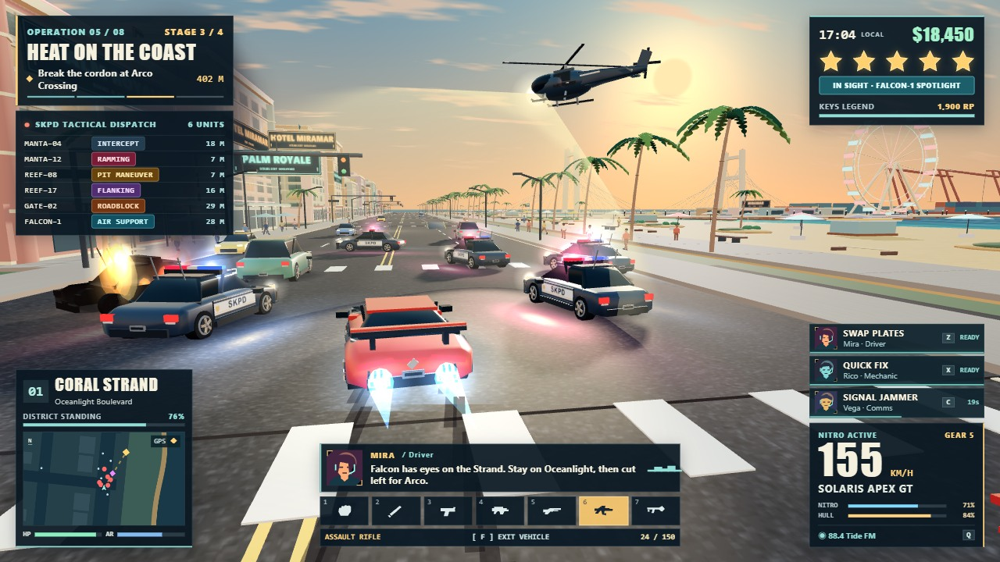
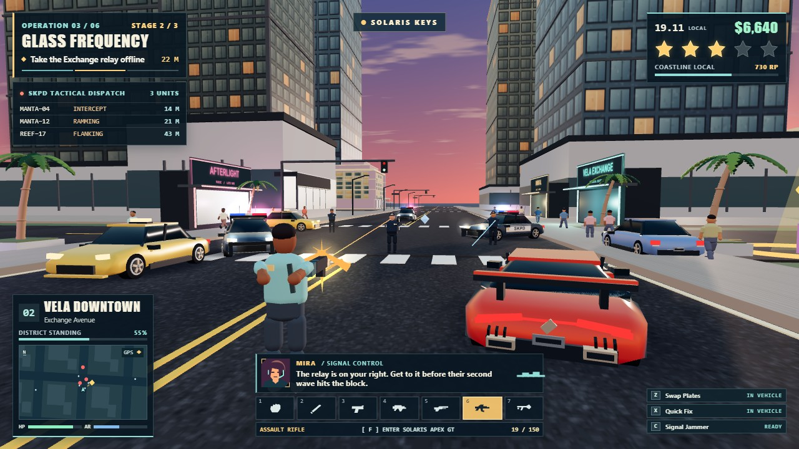
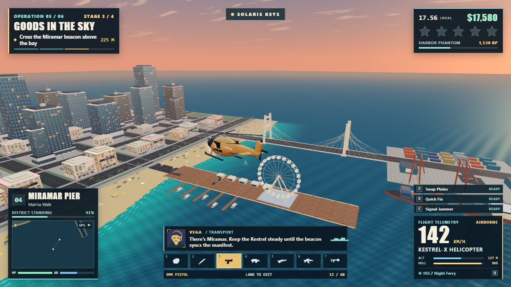
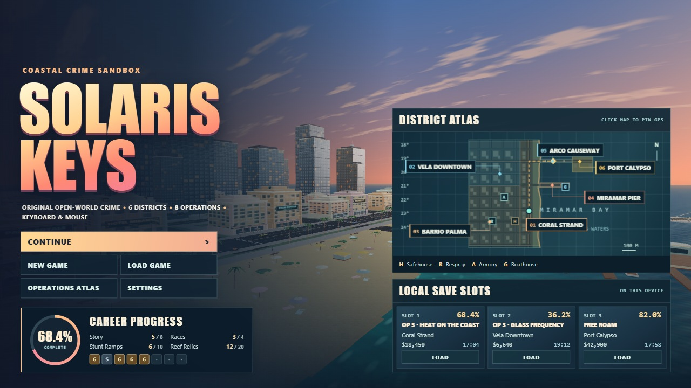

# SOLARIS KEYS

A zero-build, offline-ready 3D coastal open-world sandbox game built with Three.js and WebAudio.



## Screenshots

| On-Foot Combat | Aerial Bay View | Start Screen & Saves |
| :---: | :---: | :---: |
|  |  |  |

## Quick Start

No build step or package installation required — all dependencies (including Three.js) are bundled under `game/vendor/`.

### Run with Node.js (v22+)

```bash
node serve.ts
```

Then open [http://localhost:8080](http://localhost:8080) in a WebGL 2–capable browser. You can also pass a custom port:

```bash
node serve.ts --port 3000
```

### Run with any static server

You can also serve the `game/` directory directly with any HTTP server, for example:

```bash
python -m http.server 8080 --directory game
```

## Features

- **Six Coastal Districts**: Explore *Coral Strand*, *Vela Downtown*, *Barrio Palma*, *Miramar Pier*, *Arco Causeway*, and *Port Calypso* with dynamic day/dusk/night lighting and custom GLSL sky & ocean shaders.
- **Land, Sea & Air Vehicles**: Drive sports cars, sedans, taxis, SUVs, police interceptors, and motorcycles (`Solaris Apex GT`, `Riptide Sabre`, `Sunbird Taxi`, `Marlin LX`, `SKPD Interceptor`, `SKPD Sentinel`, `Halcyon 800`), fly helicopters (`Kestrel-X`, `Falcon-1`), and pilot boats (`Miramar Swift`).
- **8-Operation Campaign & Side Activities**: Complete story missions (*Low Tide* through *Open the Keys*) with Gold/Silver/Bronze medals, plus street races, stunt ramps, reef relics, contraband drops, and district standing.
- **Combat & 5-Star SKPD Dispatch**: 7 weapons (*Fists*, *Baton*, *9mm Pistol*, *Compact SMG*, *Pump Shotgun*, *Assault Rifle*, *RPG-7*), cover mechanics, and escalating police response including air-unit searchlights.
- **Crew Abilities**: Trigger *Mira*'s Swap Plates (`Z`), *Rico*'s Quick Fix (`X`), and *Vega*'s Signal Jammer (`C`).
- **In-Game HUD, Audio & Save Slots**: Rotating minimap, interactive Atlas, synthesized WebAudio with 3 radio stations (*88.4 Tide FM*, *96.2 Palma Pulse*, *103.7 Night Ferry*), and multi-slot `localStorage` persistence.

## Controls

| Key | Action |
| :--- | :--- |
| `W` `A` `S` `D` / Arrow Keys | Walk / steer / throttle |
| Mouse Drag | Look / orbit camera |
| `F` | Enter / exit vehicle |
| `E` | Interact / use cover |
| `Shift` | Sprint / nitro boost |
| `Space` | Handbrake / helicopter lift |
| `Ctrl` | Helicopter descend |
| Left Click | Attack / drive-by fire |
| `1`–`7` / `R` | Select / reload weapon |
| `Z` / `X` / `C` | Crew abilities (Swap Plates / Quick Fix / Signal Jammer) |
| `V` | Cycle camera view |
| `Q` / `T` | Cycle radio station / time of day |
| `M` / `Esc` | Open Atlas / pause menu |

## Project Structure

```text
.
├── game/                  # Playable browser app (zero build step)
│   ├── index.html
│   ├── styles.css
│   ├── src/               # Engine, city, vehicles, combat, police, missions, HUD, save, audio
│   └── vendor/            # Bundled three.module.min.js
├── screenshots/           # In-game showcase captures
├── serve.ts               # Lightweight Node static server for game/
├── main.ts                # Offline dossier bundler
├── shots.json             # Capture manifest
└── LICENSE                # MIT License
```

## License

MIT — see [LICENSE](./LICENSE).
